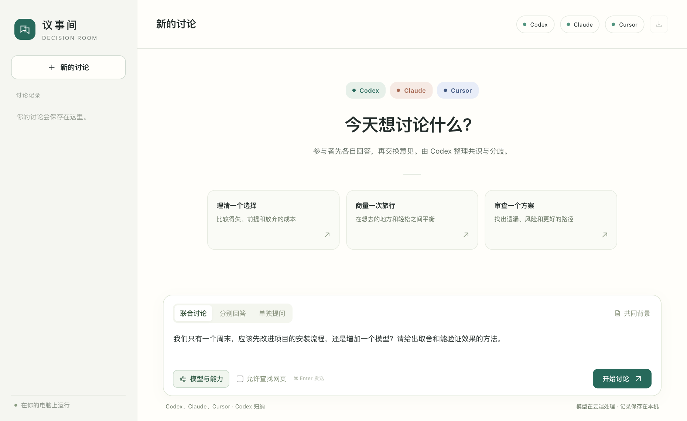

# Decision Room · 议事间

[中文](README.md) · English

Ask Codex, Claude Code and Cursor Agent the same question from one local browser window, or have them work on one plan toward a goal until all of them approve it. Each participant can use a different model and take a different role. For a design decision, for example, ask one participant to compare the options and another to look for ways the proposed approach could fail. You can read their original answers, their reviews of each other’s reasoning and a summary from the moderator you choose.



## Run it

Install Node.js 22 or newer on macOS or Linux, and sign in to at least one of the supported command-line tools.

| Participant | CLI | Sign in |
| --- | --- | --- |
| Codex | `codex` | Run `codex login` and choose your ChatGPT account. |
| Claude Code | `claude` | Run `claude auth login` with your Claude account. |
| Cursor Agent | `cursor-agent` or `agent` | Run `agent login` with your Cursor account. |

```sh
git clone https://github.com/juny1zhang/decision-room.git
cd decision-room
npm start
```

The app uses only Node.js built-in modules, so it starts directly from the clone without `npm install`. It prints a local URL in the terminal and opens it in your browser (with `open` on macOS and `xdg-open` on Linux). The address stays `http://127.0.0.1:41710/` from one launch to the next unless that port is busy; the part after `#` is the access token for this launch. Keep the terminal open while using the room. Press Ctrl+C to stop it. On a Mac, you can also double-click `Start-Decision-Room.command` next time.

## Start your first discussion

The interface, the prompts and the answers are in Chinese. Select a mode in the message composer.

| Mode | What happens | CLI calls per completed round |
| --- | --- | --- |
| Single question · 单独提问 | One participant answers. | 1 |
| Independent answers · 分别回答 | Two or three participants answer before seeing each other’s responses. | 2 or 3 |
| Joint discussion · 联合讨论 | Each participant answers independently, then reviews all the answers. The chosen moderator summarizes points of agreement and disagreement. | 5 or 7 |
| Goal mode · 目标模式 | Each participant proposes a plan; the moderator merges them into one plan, which the others review and the moderator revises until all of them approve the same version. | 2 + 2 per version with two participants, 3 + 3 per version with three (12 for three versions) |

**Goal mode** has the participants work together toward a goal. Write the goal as your question, ideally with how to tell it is reached, such as “cut the first response time of customer support to under an hour by next quarter, for four weeks in a row”. Each participant first proposes a complete plan on its own. The moderator merges the proposals into version 1 (方案 v1), choosing between conflicting ideas with a reason. Every other participant reviews it, names what must change, suggests changes that can be adopted as they are, and ends with a last line of either 结论：认可 (approve) or 结论：需修改 (needs changes). The moderator then writes the next version, starting with what changed. The moderator approves its own version; once every other participant approves the same version, the turn ends and that version is marked 最终方案 (final plan). So that quota cannot run away, **最多几版** (at most how many versions, 1 to 6, default 3) caps the versions: when the cap is reached and someone still asks for changes, the turn pauses and names who still objects, and **继续磨合** (keep refining) allows as many versions again. Every review reads the whole plan and the previous round’s reviews, so a goal turn makes more calls and uses more tokens than a joint discussion; a medium reasoning level is usually enough.

Open **模型与能力** (Models and capabilities) to choose participants, a model or custom model ID for each one, and an analysis focus such as planning, risk review or fact-checking. Available reasoning levels depend on the model. The web search checkbox controls whether participants can look up sources. Each CLI uses your account’s model access and quota.

Use **共同背景** (Shared context) to enter constraints that apply throughout the discussion, then send a question. You can change the participants for a follow-up.

When a CLI can stream its output, each answer appears as a preview marked 生成中… (writing) while it is written, with a note when the model is thinking or searching the web. Every answer shows its model, how long it took and, where the CLI reports it, the tokens used (Cursor does not). Answers render as Markdown with headings, nested lists, aligned tables, code blocks with a language caption, links and bare URLs, emphasis and strikethrough. Only http(s) links open; images and HTML are not shown.

If a connection drops, Decision Room retries the call once. A joint discussion continues as long as at least two participants answered independently, and the page says who is missing. Goal mode also needs two proposals, but it pauses when any review is missing: a missing review is not an approval. If you stop a round or a call fails, completed answers remain in the room; **重试未完成的部分** (retry the unfinished parts) later runs only the answers the round is missing.

## Where the conversation goes

Your browser connects to a service on `127.0.0.1` using an access token generated at startup. Each selected CLI sends the question, shared context and recent history to its model service. In a joint discussion, participants also receive each other’s answers for review; in goal mode, the moderator and the other participants receive the proposals, every version of the plan and the reviews.

The prompts put the question, the shared context, earlier messages and other participants’ answers in separately tagged sections, and each stage has a size budget. Up to about 48,000 characters of recent history go with each round: questions, moderator summaries and the latest version of each goal-mode plan first, then the other messages, newest first. A single message over 12,000 characters keeps only its beginning and end. Questions are limited to 20,000 characters and the shared context to 40,000. When you change the shared context, the new version is saved with your next question, and the history and the export show the context in effect for each question.

Transcripts and preferences are stored in your operating system’s application data folder. The terminal prints the exact location at startup.

| System | Location |
| --- | --- |
| macOS | `~/Library/Application Support/Decision Room/` |
| Linux | `$XDG_DATA_HOME/decision-room/`, or `~/.local/share/decision-room/` when it is not set |

Each discussion is a JSON file in `rooms/`. `preferences.json` keeps your last discussion settings and the open discussion, so they come back after a restart or in another browser. Unsent drafts stay in the browser. Earlier versions stored everything in `data/` inside the clone: while `data/rooms/` still holds discussions, Decision Room keeps using `data/` and explains in the terminal how to move it. `DECISION_ROOM_DATA_DIR` overrides both locations.

The sidebar lets you search discussions by title, reopen, rename or delete them, and export one as Markdown, including each message’s stage, local time, duration and token counts. A new discussion is named after the first line of its question. A discussion cannot be renamed or deleted while it is running.

## Check your setup

```sh
npm run check              # Check CLI login and available models without sending a question
npm test                   # Run unit and integration tests with simulated CLIs
node server.mjs --no-open  # Print the local URL without opening a browser
node server.mjs --debug    # Print diagnostics in the terminal
```

| Environment variable | Effect |
| --- | --- |
| `DECISION_ROOM_PORT` | The port to use, `0` for a random one. Without it, Decision Room uses 41710 and falls back to a random port, with a note, when 41710 is busy. A port you set that cannot be used stops the launch with an error. |
| `DECISION_ROOM_DATA_DIR` | Where transcripts and preferences are stored. |
| `DECISION_ROOM_DEBUG=1` | The same as `--debug`. |
| `DECISION_ROOM_CODEX_BIN`, `DECISION_ROOM_CLAUDE_BIN`, `DECISION_ROOM_CURSOR_BIN` | The absolute path of a CLI installed in a custom location. |

Debug mode prints lines starting with `[debug]` to the terminal: the command, arguments, folder, exit code, duration and error output of every CLI call, the results of connection checks, and the path and status of each request. Questions and answers are never printed, and keys, tokens and e-mail addresses in error output are hidden. The output can still contain local paths, your user name and fragments of CLI error messages, so read it before you share it.

Live testing on macOS returned answers from Codex, Claude Code and Cursor Agent. Behind some proxies and secure web gateways, Cursor's default HTTP/2 stream stalls and fails after minutes with "Connection stalled repeatedly", in the native CLI as well; Decision Room therefore has Cursor stream answers over HTTP/1.1, keeping the other network settings in your `~/.cursor/cli-config.json`. Set `DECISION_ROOM_CURSOR_HTTP2=1` before starting to keep Cursor's own setting instead. The automated tests exercise all three adapters with simulated CLIs, including a full three-participant discussion, goal mode and live previews. The arguments the adapters pass to Codex and Claude Code are also checked against the help output of the real CLIs, and again every week against their latest releases. Cursor Agent's help output has not been captured yet, so its arguments are only checked against the simulated CLI; the weekly check runs the latest Cursor Agent too, but its result does not fail the check yet.

## Platform support

| System | Status |
| --- | --- |
| macOS | Supported. `Start-Decision-Room.command` starts it from Finder. |
| Linux | Supported and tested in CI. `xdg-open` opens a temporary launcher page that only your user can read, which forwards to the tokenized address, so the token never appears in process arguments other users can see. Snap browsers (such as Ubuntu’s default Firefox) cannot read that page; open the address printed in the terminal instead. Without a desktop, use `--no-open` and open the printed address yourself. |
| Windows | Not supported. |

On Windows, CLIs installed with npm are `.cmd` shims, which Node.js cannot start without a shell, and Decision Room never starts a CLI through a shell so that nothing in a request can become a command. Stopping a discussion also ends the CLI’s whole process group, which only works on POSIX systems such as macOS and Linux.

## Design decisions

- **Chinese only.** The interface and the prompts are written in Chinese, and the models are asked to answer in Chinese. There is no other language yet.
- **Subscription logins only.** Before starting a CLI, Decision Room removes API key variables such as `OPENAI_API_KEY`, `ANTHROPIC_API_KEY` and `CURSOR_API_KEY`, as well as the Bedrock and Vertex settings of Claude Code and Cursor, so that a discussion is never billed to an API account by surprise. The **工具连接** (Tool connections) dialog names the API key variables it ignored.
- **No runtime dependencies.** The app uses only Node.js built-in modules and runs straight from the clone, with no third-party runtime code to audit or update. ESLint, Prettier and Playwright are development tools only.
- **Local only.** The service listens on `127.0.0.1` only, checks the Host and Origin of every request and creates a new access token at every launch. There are no user accounts and no remote access.

## Get involved

- Share ideas and discuss how you use the app. [Discussions](https://github.com/juny1zhang/decision-room/discussions)
- Report a bug with a short reproduction. [Issues](https://github.com/juny1zhang/decision-room/issues)
- Send a change to the code or documentation. [Contributing guide](CONTRIBUTING.md)
- Report a security concern privately. [Security reporting instructions](SECURITY.md)

See the [changelog](CHANGELOG.md) for what changed between versions. Decision Room is distributed under the [MIT License](LICENSE).
