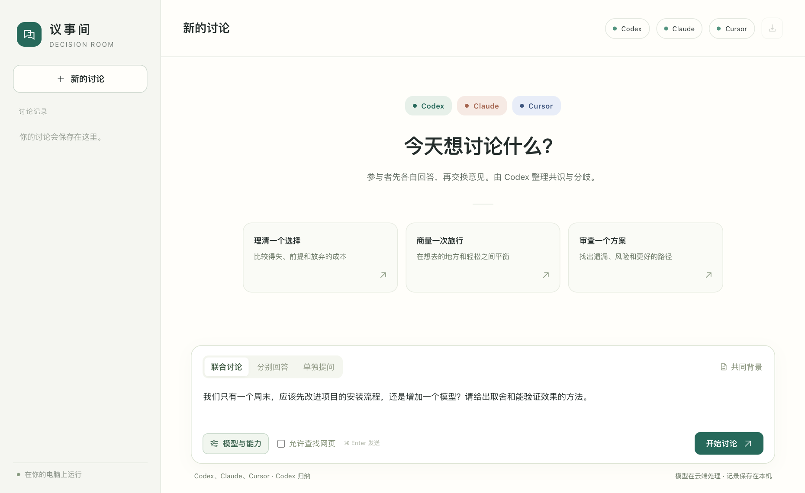

# 议事间 · Decision Room

[English](README.en.md)

在同一个浏览器窗口里，让你已登录的 Codex、Claude Code 和 Cursor Agent 讨论一个问题。你可以给每位参与者选模型、分配分析侧重，再指定一位主持人梳理共识和分歧。每个判断都能追溯到原始发言，之后还可以在同一场讨论里追问。



## 快速开始

在 Mac 上准备 Node.js 18 或更新版本。要获得真实回答，先在终端登录至少一个模型 CLI。只想开发或运行测试时，只需要 Node.js 和 npm。

| 参与者 | 程序 | 登录方式 |
| --- | --- | --- |
| Codex | `codex` | `codex login`，选择 ChatGPT 账号 |
| Claude Code | `claude` | `claude auth login`，使用 Claude 账号 |
| Cursor Agent | `cursor-agent` 或 `agent` | `agent login` |

```sh
git clone https://github.com/juny1zhang/decision-room.git
cd decision-room
npm start
```

项目只使用 Node.js 内置模块。启动后，终端会打印本次访问地址，并在 macOS 上打开浏览器。保留这个终端窗口，结束时按 Ctrl+C。下次也可以在 Finder 中双击 `Start-Decision-Room.command`。

## 第一场讨论

假设你的问题是「我们有两名开发者、两周时间，应该直接发布新功能，还是先邀请十位用户试用？」如果只登录了一家 CLI，选「单独提问」就能开始。两家都已就绪时，可以让它们一起讨论。

1. 选择「联合讨论」，在「共同背景」里写下已知约束，例如「发布后可以回滚，但团队没有专人值班」。
2. 打开「模型与能力」，为 Claude 选择「方案规划」，为 Codex 选择「风险审查」，指定其中一位主持归纳。模型可以保留 CLI 默认值，从列表选择，或手动输入模型 ID。
3. 发送问题。先读两份独立意见，再看双方怎样回应彼此。可以追问「如果能多安排一位测试人员，哪条建议会变？」或导出 Markdown 分享给团队。

| 模式 | 适用场景 | 一轮完整讨论的 CLI 调用 |
| --- | --- | --- |
| 单独提问 | 针对某位参与者的判断继续追问 | 1 次 |
| 分别回答 | 比较各方在同一背景下独立给出的答案 | 每位 1 次 |
| 联合讨论 | 独立回答后互审，再由选定的主持人归纳 | 两位 5 次，三位 7 次 |

分析能力包括综合分析、事实核查、风险审查、方案规划和方案比较。推理强度选项取决于所选模型和 CLI。需要核对最新资料时，可开启「允许查找网页」。停止讨论会保留已完成的发言。如果某位参与者在分析或互审阶段失败，页面会显示错误，并保留其余参与者已经完成的内容。

## 记录和模型服务

议事间只监听 `127.0.0.1`。浏览器连接本机服务，所选 CLI 将问题、共同背景及参与本轮所需的历史发给各自的模型服务，使用对应账号的额度。联合讨论的互审阶段还会把本轮独立意见发给其他参与者。每次启动都会生成新的访问凭证，终端里的完整地址仅供自己使用。

每场讨论保存在 `data/rooms/` 下，可从侧栏重新打开或导出 Markdown。备份时复制 `data/`，也可以通过 `DECISION_ROOM_DATA_DIR` 指定其他目录。每轮最多选取约 48,000 字符的近期历史。问题上限为 20,000 字符，共同背景上限为 40,000 字符。完整记录仍可查看和导出。

## 连接检查与测试

```sh
npm run check              # 检查本机 CLI、账号登录和模型目录
npm test                   # 使用模拟 CLI，运行集成测试
node server.mjs --no-open  # 仅在终端打印本次访问地址
```

如果应用找不到 CLI，可通过 `DECISION_ROOM_CODEX_BIN`、`DECISION_ROOM_CLAUDE_BIN` 或 `DECISION_ROOM_CURSOR_BIN` 指定可执行文件的绝对路径。

在 macOS 的真实账号测试中，Codex 和 Claude 已经返回回答。Cursor 已验证登录和模型目录读取，真实回答的连接在该测试环境中反复中断。遇到相同现象时，可在空目录运行 `agent --mode ask` 并发送一句简短问题，检查原生 CLI 连接。自动化测试使用三个模拟 CLI，覆盖模型选择、三方讨论、停止、旧记录续聊和导出。

## 参与社区

- 分享一段可复现的问题和使用的 CLI 版本，帮助改进兼容性。[提交 Issue](https://github.com/juny1zhang/decision-room/issues)
- 交流模型分工、讨论模式或下一项功能。[加入 Discussions](https://github.com/juny1zhang/decision-room/discussions)
- 修改代码或文档可以直接提交 Pull Request。[贡献指南](CONTRIBUTING.md)
- 报告可能泄露讨论内容或凭证的问题，请使用私下报告渠道。[安全报告](SECURITY.md)

本项目采用 MIT 许可证。[许可证全文](LICENSE)
